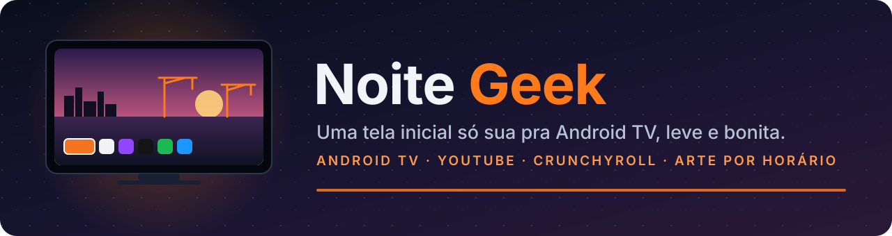
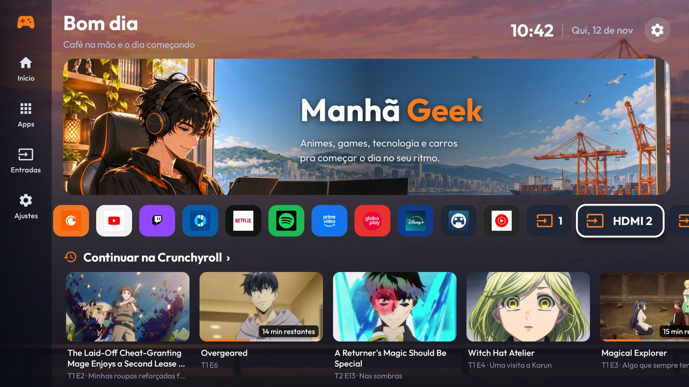
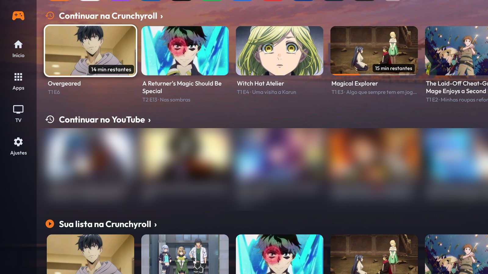
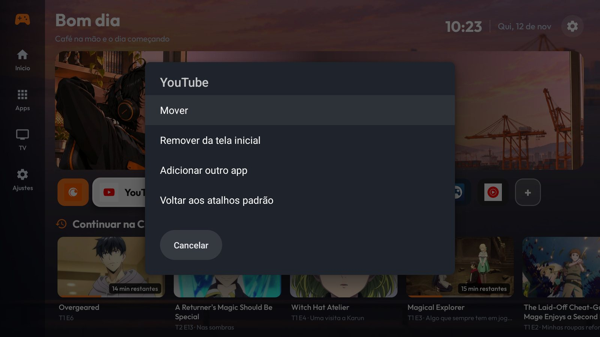
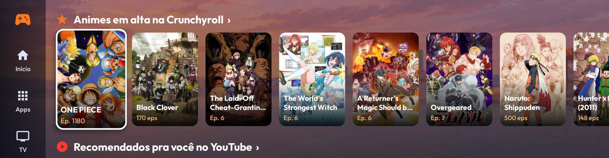
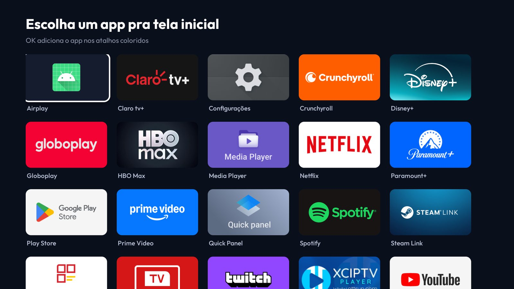
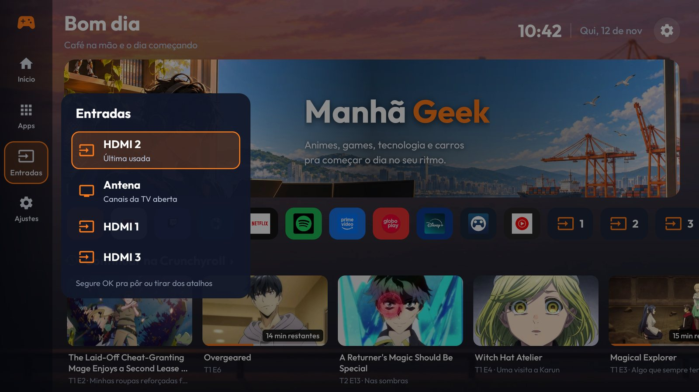
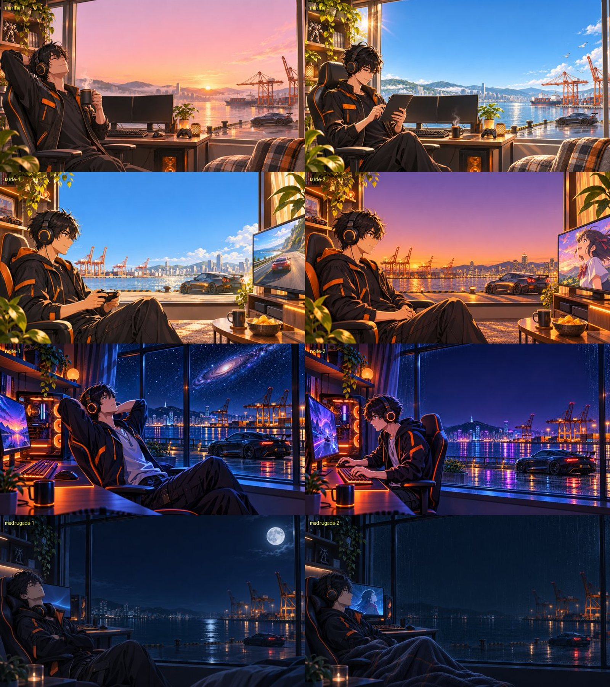
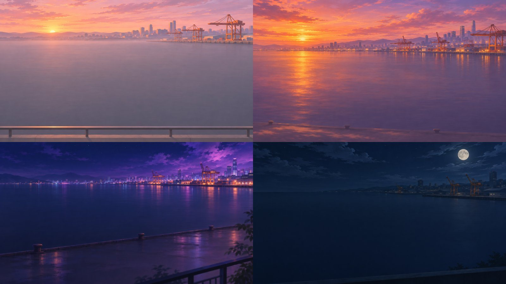
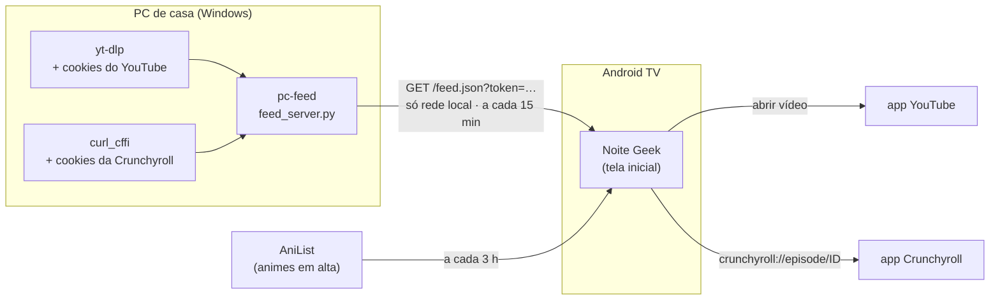

<p align="center">
  
</p>

<p align="center">
  
  
  
  
  <a href="LICENSE"></a>
</p>

<p align="center">
  Uma tela inicial feita sob medida pra Android TV, no lugar da tela cheia de propaganda do Google TV.<br>
  A arte muda com o <b>horário do dia</b>, o seu <b>YouTube</b> e a sua <b>Crunchyroll</b> aparecem na tela,
  e tudo isso gastando <b>~70 MB</b> de memória (a tela do Google TV usa 200–300 MB).
</p>

<p align="center">
  
</p>

---

## Recursos

<table>
  <tr>
    <td width="33%" valign="top">
      <br>
      <b>Arte que muda com o horário</b><br>
      Manhã, tarde, noite e madrugada, cada uma com dois banners e um papel de parede próprio. A saudação e o título ("Noite <i>Geek</i>") acompanham.
    </td>
    <td width="33%" valign="top">
      <br>
      <b>Crunchyroll de verdade</b><br>
      <i>Continuar assistindo</i> com barra de progresso, a sua lista e os animes em alta. Um clique abre o episódio no player, de onde você parou.
    </td>
    <td width="33%" valign="top">
      <br>
      <b>O seu YouTube</b><br>
      Histórico, recomendados e novidades das inscrições do <b>seu</b> canal (dá pra escolher entre os canais da conta). Abre direto no app do YouTube.
    </td>
  </tr>
  <tr>
    <td valign="top">
      <br>
      <b>Atalhos que você arruma</b><br>
      Ícones coloridos que mostram o nome ao selecionar. Segure OK pra mover ou remover; o “+” adiciona qualquer app.
    </td>
    <td valign="top">
      <br>
      <b>Leve de propósito</b><br>
      Java puro, sem bibliotecas. Imagens já no tamanho certo e em RGB_565, cache em disco, nada de vídeo nem desfoque ao vivo.
    </td>
    <td valign="top">
      <br>
      <b>O trabalho pesado fica no PC</b><br>
      Um servidorzinho em Python no seu PC lê as contas e entrega uma lista pronta, só pra rede de casa, com token.
    </td>
  </tr>
  <tr>
    <td valign="top">
      <br>
      <b>Entradas HDMI e antena</b><br>
      Botão <b>Entradas</b> no menu lateral e as portas HDMI nos atalhos, com o número da porta. Usa o nome que você deu na TV.
    </td>
    <td valign="top">
      <br>
      <b>Volta pro videogame</b><br>
      A última entrada usada fica no topo do painel, e segurar OK em <b>Entradas</b> volta direto pra ela.
    </td>
    <td valign="top">
      <br>
      <b>HDMI-CEC</b><br>
      Quando a TV reconhece o aparelho, aparece o nome dele ("HDMI 1 · PlayStation 5"). Com o CEC ligado (T-Link na TCL), trocar de entrada acorda o aparelho e o controle passa a comandá-lo.
    </td>
  </tr>
</table>

## Telas

<table>
  <tr>
    <td width="50%"><br><sub><b>Fileiras</b>: continuar na Crunchyroll (com quanto falta), continuar no YouTube (desfocado aqui, é o meu histórico) e a sua lista.</sub></td>
    <td width="50%"><br><sub><b>Atalhos</b>: segure OK num app pra mover, remover ou adicionar outro.</sub></td>
  </tr>
  <tr>
    <td><br><sub><b>Em alta</b>: os animes mais populares do momento que estão na Crunchyroll, via AniList.</sub></td>
    <td><br><sub><b>Apps</b>: todos os apps da TV com os banners oficiais; o “+” abre esta tela pra escolher.</sub></td>
  </tr>
  <tr>
    <td colspan="2" align="center"><br><sub><b>Entradas</b>: antena e HDMIs, com a última usada no topo. Segure OK numa entrada pra pôr ou tirar dos atalhos.</sub></td>
  </tr>
</table>

### A arte de cada horário

<p align="center">
  <br>
  <sub>Os 8 banners (dois por período, trocam a cada 1h30), gerados com o <a href="https://github.com/openai/codex">Codex</a>.</sub>
</p>
<p align="center">
  <br>
  <sub>Os papéis de parede de fundo: o mesmo porto, sem personagem, pra não brigar com as fileiras.</sub>
</p>

## Como funciona



- O **PC** atualiza as listas a cada 40 minutos e guarda a última que deu certo. Se um cookie vencer, a fileira continua com a lista anterior em vez de sumir.
- A **TV** só baixa um JSON pequeno e as miniaturas (que ficam em cache). Sem o PC ligado, ela mostra a última lista que recebeu.
- Nenhuma senha passa pela TV: as contas ficam no PC, em arquivos de cookies que não vão pro git.
- Parada na tela inicial, a TV confere a cada minuto se alguma lista venceu e só então baixa de novo.
- **Entradas:** a lista vem da própria TV (`TvInputManager`) e a troca é o pedido padrão do Android (abrir o endereço da entrada como canal), que na TCL quem atende é o app de TV dela. Testado na TCL: Antena, HDMI 1, 2 e 3.

## Antes: limpar a TV com o CleanYourTV

 Este projeto nasceu junto com uma limpeza da TV feita com o **[CleanYourTV](https://github.com/Gathin23/cleanyourtv)**, de [@Gathin23](https://github.com/Gathin23): ele desativa (sem desinstalar) a telemetria, a propaganda e os apps de fábrica, guarda backup de tudo e desfaz com um comando.

O Noite Geek usa as ferramentas dele pra falar com a TV: o `instalar.sh` chama o `tools/tv.py` (ADB por Wi-Fi em Python) e o `tools/b64push.py` do CleanYourTV. Por isso, clone os dois lado a lado:

```
pasta/
├── cleanyourtv/   ← git clone https://github.com/Gathin23/cleanyourtv
└── noite-geek/    ← este repositório
```

Siga o [`PROMPT.md`](https://github.com/Gathin23/cleanyourtv/blob/main/PROMPT.md) do CleanYourTV pra ligar a depuração, autorizar o PC e (se quiser) limpar a TV. Ele também tem as regras de segurança que este projeto segue pra trocar a tela inicial.

## Instalação

 **1. Feed no PC** (Windows, Python 3.12)

```bash
cd noite-geek/pc-feed
python -m venv venv
venv/Scripts/pip install -r requirements.txt
```

Exporte os cookies numa **janela anônima** com a extensão *Get cookies.txt LOCALLY* (libere ela no modo anônimo): entre no site, exporte, salve na pasta `pc-feed` e **feche a janela anônima na hora** (se ela ficar aberta, o site troca os cookies e o arquivo para de valer).

| Arquivo | Site |
|---|---|
| `cookies.txt` | youtube.com |
| `cookies_crunch.txt` | crunchyroll.com (opcional) |

Rode uma vez pra criar o `config.json` com o token e conferir:

```bash
venv/Scripts/python -I feed_server.py --once
```

Pra ele iniciar com o Windows: Win+R → `shell:startup` → crie ali um **atalho** pro `iniciar-feed.vbs`. Pra ter o comando `noite-feed`, ponha a pasta `pc-feed/bin` no PATH. Detalhes em [`pc-feed/LEIA-ME.md`](pc-feed/LEIA-ME.md).

> [!IMPORTANT]
> Libere a porta **8787** no Firewall do Windows só pra **rede privada**. O feed responde só pra IPs da rede de casa (`allow` no `config.json`) e só com o token.

 **2. App na TV** (JDK 17, Android SDK 34, build-tools 34.0.0)

```bash
cd noite-geek
cp instalar.conf.example instalar.conf             # IP da TV e pasta do CleanYourTV
cp app/feed.properties.example app/feed.properties # IP do PC e o token do pc-feed/config.json
bash instalar.sh                                   # compila, envia e instala pela rede
```

Sem o `feed.properties` o app funciona igual, só sem as fileiras do YouTube e da Crunchyroll.

 **3. Virar a tela inicial**

Faça como o CleanYourTV manda, nesta ordem (o `tools/disable.sh` dele tem as travas de segurança):

1. `cmd package set-home-activity --user 0 com.evert.noitegeek/.MainActivity` e aperte Home pra conferir.
2. No **Google TV** isso costuma não bastar: desative o launcher do Google (`com.google.android.apps.tv.launcherx`) **junto** com o `setupwraith`, numa lista própria, com o `tools/disable.sh`.
3. Antes, confira de quem é o Wi-Fi salvo: `dumpsys wifi | grep -o 'cname=[^ ]*'`. Se a rede em uso for do `setupwraith`, esqueça e entre de novo na rede pelas Configurações antes, senão a TV cai do Wi-Fi.
4. Reinicie e confira se o Noite Geek e o ADB voltaram.

> [!WARNING]
> Desfazer é um comando: `bash tools/restore.sh sua-lista.txt` no CleanYourTV traz a tela do Google TV de volta. Nunca desinstale nada; desative.

## Usando

| No controle | O que faz |
|---|---|
| **OK** num atalho | abre o app |
| **Segurar OK** num atalho | menu: mover, remover, adicionar outro, voltar ao padrão |
| **◀ ▶** depois de “Mover” | leva o atalho pro lado; **OK** solta |
| **Segurar OK** num app (tela Apps) | coloca ele nos atalhos |
| **OK** em **Entradas** (menu lateral) | painel com antena e HDMIs |
| **Segurar OK** em **Entradas** | volta direto pra última entrada usada |
| **Segurar OK** numa entrada do painel | põe ou tira ela dos atalhos |

> [!NOTE]
> Comandos HDMI-CEC próprios (ligar ou desligar um aparelho, por exemplo) o Android só deixa pra apps do sistema. O Noite Geek troca de entrada do jeito padrão, e a TV cuida do CEC sozinha.
| **Home** ou **Voltar** | volta pro topo |
| **Menu** | abre as Configurações da TV |

 No PC, o comando `noite-feed`:

```bash
noite-feed                      # está rodando? últimas linhas do log
noite-feed reiniciar            # atualiza as listas agora
noite-feed canal @seu_canal     # qual canal do YouTube usar, se a conta tiver vários
noite-feed parar | iniciar | log | pasta
```

## Personalizar

- **Atalhos padrão:** `app/app/src/main/res/values/config.xml` (`pacote|nome|cor do fundo|cor do texto`). Pela TV dá pra mudar tudo sem recompilar.
- **Arte:** `arte/gerar.sh` e `arte/gerar-fundos.sh` pedem as imagens ao Codex (`codex exec`); `arte/preparar.py` recorta os banners, gera os fundos e o ícone do app. Troque os textos dos prompts e gere de novo.
- **Textos e horários:** `Period.java` (saudações, títulos, quando começa cada período).
- **Frequência:** `refresh_min` no `pc-feed/config.json` (PC) e `YT_TTL` no `MainActivity.java` (TV).

## Privacidade e segurança


- Os cookies dão acesso às suas contas: ficam só no PC e estão no `.gitignore`, junto com o `config.json`, o `feed.properties` e o `instalar.conf`.
- O feed só lê. Pra Crunchyroll ele usa o mesmo acesso que o site usa por dentro (não há API oficial); pode quebrar se o site mudar.
- O token do feed é gerado sozinho e a porta só responde pra rede local. A TV não guarda senha nenhuma.
- Depois de terminar, desligue a depuração da TV (o CleanYourTV explica como fechar o ADB).

## Testado em

TCL Smart TV Pro (Google TV, Android TV 12), 4K, com o PC no cabo e a TV no Wi-Fi.

## Créditos


- **[CleanYourTV](https://github.com/Gathin23/cleanyourtv)** de [@Gathin23](https://github.com/Gathin23) (MIT): a limpeza da TV, as ferramentas de ADB (`tv.py`, `b64push.py`), as regras de segurança pra trocar a tela inicial e o Gradle wrapper que este app usa. Sem ele este projeto não existiria.
- **[yt-dlp](https://github.com/yt-dlp/yt-dlp)** (Unlicense): lê os feeds do YouTube.
- **[curl_cffi](https://github.com/lexiforest/curl_cffi)** (MIT): fala com a Crunchyroll como um navegador.
- **[AniList](https://anilist.co)**: API pública dos animes em alta.
- **[Outfit](https://fonts.google.com/specimen/Outfit)** (SIL OFL 1.1): a fonte do app ([licença](app/FONT-LICENSE-OFL.txt)).
- Arte gerada com o **[Codex](https://github.com/openai/codex)**.

Projeto pessoal, sem ligação com Google, YouTube, Crunchyroll, AniList ou TCL. Os nomes e ícones dos apps pertencem aos seus donos.

## Licença

[MIT](LICENSE). Use, modifique e compartilhe à vontade.
